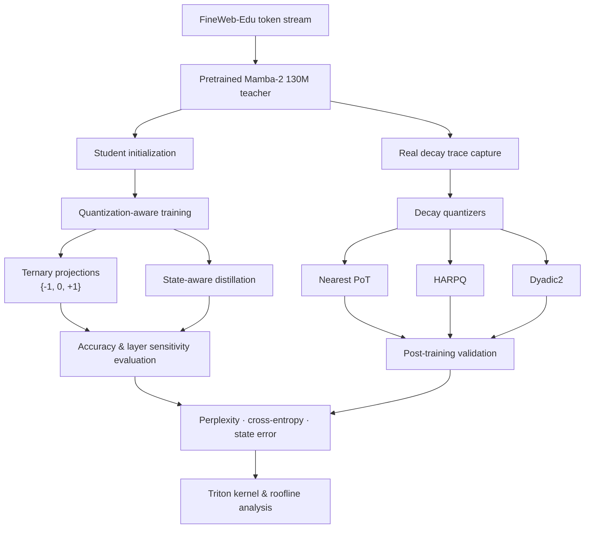

# ⚡ SHIFT-SCAN

### Power-of-Two Decay & Ternary Projections for Multiplication-Free State Space Language Models

**Exploring lower-cost computation in Mamba-2 without losing sight of model quality or real GPU performance.**

---

## ✦ The idea

State Space Models (SSMs) such as **Mamba-2** keep a fixed-size recurrent state instead of maintaining a growing Transformer KV cache. However, their projections and recurrent state updates still involve dense multiplications.

**Shift-Scan asks a focused question: can selected multiplications be replaced with additions, subtractions, zero-skipping, and bit shifts while keeping language-model quality usable?**

The project investigates two complementary directions:

- **Ternary projections:** constrain selected projection weights to `{-1, 0, +1}`.
- **Power-of-two decay:** approximate the recurrent decay coefficient with a shift-friendly representation, `a_hat = 1 - 2^-k`.

This is an experimental research project—not a claim of a finished accelerated inference engine. The results include both successful findings and negative hardware results.

## 🧠 Architecture at a glance

### Two optimization paths

| Path | Representation | Intended operation |
|---|---|---|
| Ternary projection | `W ∈ {-1, 0, +1}` with scales | Add / subtract / skip |
| Power-of-two decay | `a_hat = 1 - 2^-k` | Shift-friendly decay |
| Dyadic2 decay | `1-a ≈ 2^-i + 2^-j` | Two-term dyadic approximation |

## 🔬 What was tested

**Model:** Mamba-2 130M  
**Dataset:** FineWeb-Edu  
**Hardware:** NVIDIA Tesla T4-class GPU (Colab / Kaggle)  
**Training:** FP16 QAT, state-aware distillation, sequence length 1024  
**Validation:** Cached FineWeb-Edu stream, paired bootstrap confidence intervals, and context-position analysis.

The experiments deliberately keep two evidence tiers separate:

1. **Trained results:** quantization-aware training runs and their reported perplexity.
2. **Post-training results:** quantizers and layer perturbations evaluated on the pretrained model without retraining.

## 📊 Results that matter

### 1. Ternary model training

| Configuration | FineWeb-Edu PPL |
|---|---:|
| FP student reference | **23.10** |
| TWN ternary, 4M tokens (3 seeds) | **31.83 ± 0.10** |
| TWN ternary, 12M tokens (single run) | **29.28** |

The strongest recipe used **Ternary Weight Networks (TWN)**, a gradual quantization ramp, learned scales, and selected full-precision-sensitive projection rows. The ternary student still has an accuracy gap against the FP student.

### 2. Decay quantization comparison

| Method | PPL | Δ Cross-entropy (nats) |
|---|---:|---:|
| FP baseline | 20.215 | 0 |
| Nearest PoT | 20.659 | +0.0218 |
| HARPQ | 20.669 | +0.0222 |
| **Dyadic2** | **20.330** | **+0.0057** |

Dyadic2 was significantly better than Nearest PoT in the paired comparison (95% confidence interval for the difference: `[-0.0175, -0.0146]` nats). HARPQ was statistically indistinguishable from Nearest PoT in this evaluation.

### 3. Layer sensitivity

Ternarization damage is highly concentrated. Perturbing layer 0 alone increased cross-entropy by **42.15 nats**; layer 23 increased it by **4.67 nats**. This motivates sensitivity-guided mixed precision rather than applying the same quantization policy uniformly to every layer.

*The plotted values are selected layer results from the post-training sensitivity experiment; the remaining layers had increases between 0.11 and 0.50 nats.*

### 4. Hardware reality check

| Kernel | Execution time |
|---|---:|
| FP16 projection | 0.159 ms |
| Custom ternary Triton projection | 12.98 ms |

The custom ternary kernel was approximately **80× slower** than FP16 in the measured configuration. The experiment demonstrates that removing multiplications on paper does not automatically produce faster GPU execution. The report's roofline analysis suggests that practical gains are most plausible in bandwidth-bound, small-batch decoding, with a purpose-built bit-packed, lookup-table, or popcount-style implementation.

## ⚙️ Methods & implementation

- Ternary quantization methods: absolute-mean, activation-aware, and TWN.
- Straight-through-estimator-based quantization-aware training.
- State-aware knowledge distillation.
- Learned group scales and gradual quantization schedules.
- Decay quantizers: Nearest PoT, HARPQ, and Dyadic2.
- Paired bootstrap evaluation (4,000 resamples, 95% intervals).
- Long-context loss-by-position analysis up to 4,096 tokens.
- Custom Triton kernel experiment and roofline analysis.

## ⚠️ Limitations

- The best ternary student remains less accurate than the FP student.
- Some trained comparisons are single-seed; the 12M-token result is not a multi-seed result.
- Long-context validation reaches 4,096 tokens, not beyond.

## 📚 References

1. Gu & Dao — [Mamba: Linear-Time Sequence Modeling with Selective State Spaces](https://arxiv.org/abs/2312.00752)
2. Dao & Gu — [Transformers are SSMs: Generalized Models and Efficient Algorithms Through Structured State Space Duality](https://arxiv.org/abs/2405.21060)
3. Ma et al. — [The Era of 1-bit LLMs: All Large Language Models are 1.58 Bits](https://arxiv.org/abs/2402.17764)
4. Li, Zhang & Liu — [Ternary Weight Networks](https://arxiv.org/abs/1605.04711)
5. Bengio, Léonard & Courville — [Estimating or Propagating Gradients Through Stochastic Neurons](https://arxiv.org/abs/1308.3432)
6. Penedo et al. — [The FineWeb Datasets](https://arxiv.org/abs/2406.17557)

Related SSM quantization work, including Quamba, Quamba2, and Slender-Mamba, is discussed in the report; full bibliographic details should be verified before formal submission.

---

**Shift-Scan · Undergraduate Research Project · November 2026**

