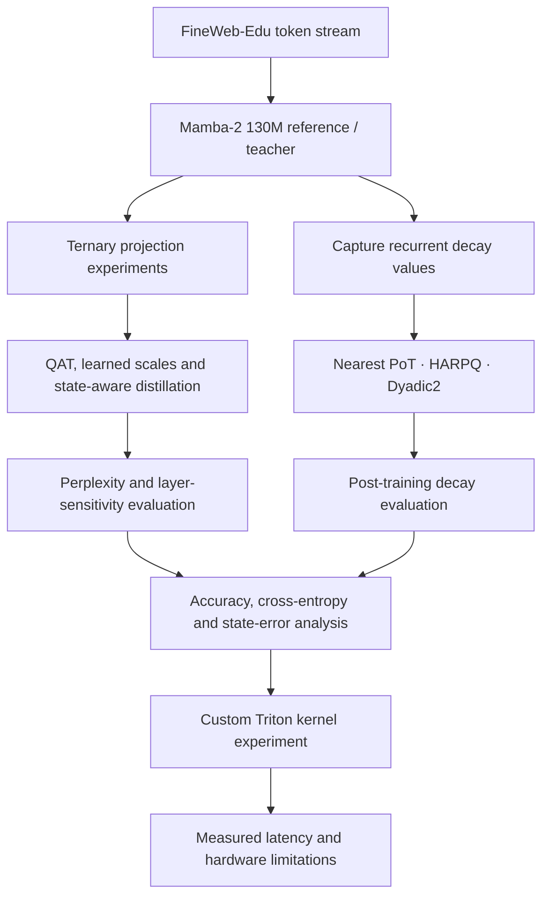
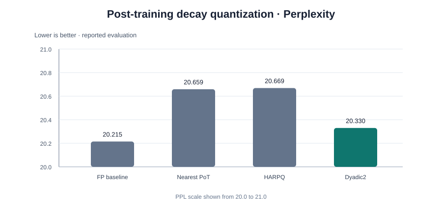
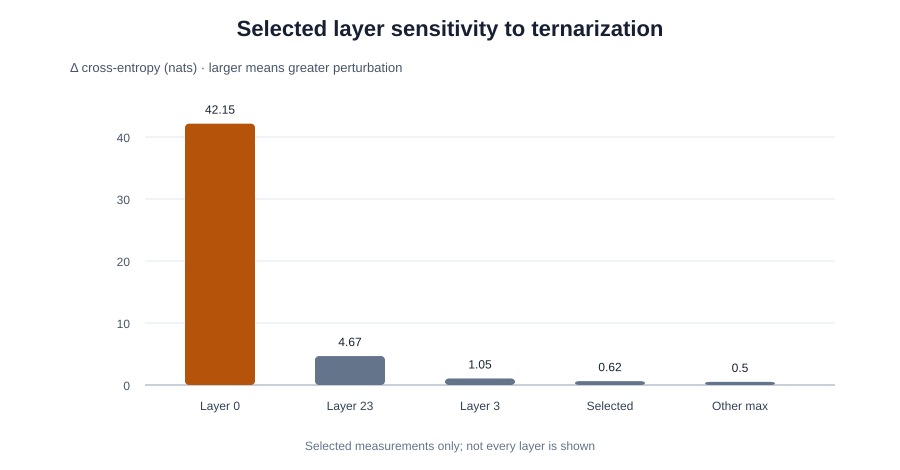
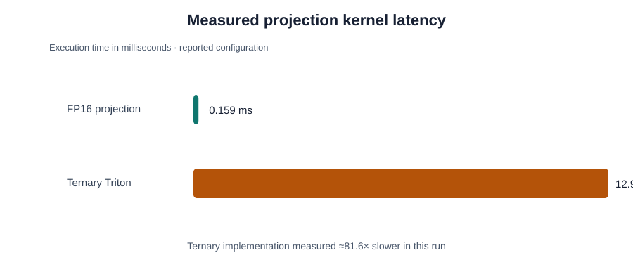

# SHIFT-SCAN

### Power-of-Two Decay & Ternary Projections for Multiplication-Free State Space Language Models

**An empirical study of multiplication-reduced computation in Mamba-2 — including accuracy trade-offs and a negative GPU-kernel result.**

---

## Research question

Can selected multiplications in a state-space language model be replaced by additions, subtractions, zero-skipping, or bit-shift-friendly operations without making language-model quality unusable?

Shift-Scan investigates two complementary approaches:

1. **Ternary projections** — constrain selected weights to `{-1, 0, +1}`, with learned scales.
2. **Power-of-two decay approximations** — represent recurrent decay using shift-friendly dyadic values, including `a_hat = 1 - 2^-k`.

This is an experimental research project, not a claim that a faster inference engine has been demonstrated. The measured custom ternary Triton kernel was slower than the FP16 reference; that result is reported explicitly below.

## Method overview

### Optimization paths

| Path | Representation | Intended arithmetic |
|---|---|---|
| Ternary projection | `W ∈ {-1, 0, +1}` with scales | Add, subtract, or skip |
| Nearest PoT decay | `a_hat = 1 - 2^-k` | Shift-friendly decay |
| Dyadic2 decay | `1-a ≈ 2^-i + 2^-j` | Two-term dyadic approximation |
| HARPQ | Learned / structured decay quantization | Quantized recurrent decay |

## Experimental setup

| Item | Reported setup |
|---|---|
| Model | Mamba-2 130M |
| Dataset | FineWeb-Edu |
| Hardware | NVIDIA Tesla T4-class GPU (Colab / Kaggle experiments) |
| Training approach | FP16 QAT, learned scales, gradual quantization, state-aware distillation |
| Sequence length | 1,024 for the reported training setup |
| Long-context analysis | Up to 4,096 tokens |
| Kernel implementation | Custom Triton ternary projection experiment |

The project contains both **trained-model experiments** and **post-training perturbation / quantizer evaluations**. Their metrics should not be compared as if they came from one identical evaluation run.

## Main results

### 1. Ternary projection training

| Configuration | FineWeb-Edu perplexity |
|---|---:|
| FP student reference | **23.10** |
| TWN ternary, 4M tokens (3 seeds) | **31.83 ± 0.10** |
| TWN ternary, 12M tokens (single run) | **29.28** |

The reported TWN recipe used gradual quantization, learned scales and selected full-precision-sensitive projection rows. The ternary student retains a clear quality gap relative to the FP student. The 12M-token result is a single run and should not be interpreted as a multi-seed estimate.

### 2. Post-training decay quantization

| Method | PPL | Δ cross-entropy (nats) |
|---|---:|---:|
| FP baseline | 20.215 | 0 |
| Nearest PoT | 20.659 | +0.0218 |
| HARPQ | 20.669 | +0.0222 |
| **Dyadic2** | **20.330** | **+0.0057** |

In this post-training evaluation, Dyadic2 had the smallest reported cross-entropy increase. The paired comparison against Nearest PoT reported a 95% confidence interval of **[-0.0175, -0.0146] nats** for the difference. This statement applies to that specific paired evaluation; it should not be generalized to the separate low-seed training summary.

### 3. Layer sensitivity to ternarization

The perturbation cost is highly non-uniform: layer 0 produced a reported Δ cross-entropy of **+42.15**, while layer 23 produced **+4.67**. Layer 3 was **+1.05**; other selected layers were approximately **+0.55 to +0.62**, with remaining reported layers between **+0.11 and +0.50**.

This supports investigating sensitivity-guided mixed precision rather than applying one quantization policy uniformly. These are selected post-training sensitivity measurements, not a complete per-layer table.

### 4. Hardware reality check

| Kernel | Measured execution time |
|---|---:|
| FP16 projection | 0.159 ms |
| Custom ternary Triton projection | 12.98 ms |

The measured ternary kernel was approximately **81.6× slower** in this configuration. Removing multiplications at the mathematical level did not translate into a GPU speedup. A practical implementation would need hardware-aware packing and execution strategies, followed by repeatable latency and throughput benchmarks.

## Repository map

### Research documents
- [Full research report (PDF)](docs/Research_Report.pdf)
- [Reproducibility notes](docs/REPRODUCIBILITY.md)
- [Seed-variance report](docs/seed-variance-report.md)

### Notebooks
- **Training:** [Final Colab experiments](notebooks/training/ShiftScan_Final_Experiments_Colab.ipynb), [Drive-ready experiment companion](notebooks/training/ShiftScan_Final_Experiments_Colab_DriveFolders.ipynb), [HARPQ 100M Colab](notebooks/training/ShiftScan_HARPQ_100M_Colab.ipynb), [HARPQ 20M Kaggle](notebooks/training/ShiftScan_HARPQ_20M_Kaggle.ipynb)
- **Evaluation:** [Evaluation and ablation](notebooks/evaluation/ShiftScan_Evaluation_and_Ablation.ipynb), [Controlled validation suite](notebooks/validation/ShiftScan_Controlled_Validation.ipynb)
- **Analysis:** [Results analysis (no checkpoint)](notebooks/analysis/ShiftScan_Results_Analysis_No_Checkpoint.ipynb), [Kaggle matched matrix](notebooks/analysis/ShiftScan_Kaggle_Matched_Matrix.ipynb)
- **Roadmap:** [Remaining research experiments](notebooks/roadmap/ShiftScan_Research_Roadmap.ipynb)
- **Historical notebook variants:** preserved under [notebooks/archive/](notebooks/archive/)

### Experiment artifacts
- [Figures](results/figures/)
- Checkpoint/output bundle: `results/checkpoints/`
- Recovered run records: `results/recovered_runs/`
- Original ZIP bundles: `archives/experiment_bundles/`

The historical ZIP bundles and older notebook variants are retained for provenance. Exact duplicate copies of the checkpoint bundle and recovered JSONL were deduplicated by identical Git blob SHA; the canonical copies remain.

## Reproducibility and interpretation

The seed-variance report records only **two seeds per method** for its `student_ppl` analysis and warns that estimates and p-values are unstable at this sample size. Treat it as exploratory evidence, not a statistically conclusive ranking. Its perplexity values (around 98–103) come from a different evaluation artifact/configuration than the post-training decay comparison above (around 20 PPL); the tables are not directly comparable.

Before claiming an experiment is fully reproducible, record the exact checkpoint, data split / token stream, tokenizer, evaluation script, sequence length, seed, software versions and hardware for that run.

## Limitations

- The ternary student has a material perplexity gap against the FP student.
- The 12M-token ternary result is single-seed.
- The separate seed-variance summary has only two seeds per method.
- Long-context analysis reaches 4,096 tokens.
- The custom ternary Triton kernel is substantially slower than the FP16 reference in the measured configuration.
- Broad latency, throughput, memory and energy benchmarks have not yet been established.

## Next steps

1. Sensitivity-guided mixed-precision allocation.
2. Optimized bit-packed / fused ternary kernels and hardware-aware profiling.
3. Broader latency, throughput, memory and energy measurements.
4. More seeds and matched evaluation configurations.
5. A clean, pinned environment and one documented command / notebook path per reported result.

## References

1. Gu & Dao — [Mamba: Linear-Time Sequence Modeling with Selective State Spaces](https://arxiv.org/abs/2312.00752)
2. Dao & Gu — [Transformers are SSMs: Generalized Models and Efficient Algorithms Through Structured State Space Duality](https://arxiv.org/abs/2405.21060)
3. Ma et al. — [The Era of 1-bit LLMs: All Large Language Models are 1.58 Bits](https://arxiv.org/abs/2402.17764)
4. Li, Zhang & Liu — [Ternary Weight Networks](https://arxiv.org/abs/1605.04711)
5. Bengio, Léonard & Courville — [Estimating or Propagating Gradients Through Stochastic Neurons](https://arxiv.org/abs/1308.3432)
6. Penedo et al. — [The FineWeb Datasets](https://arxiv.org/abs/2406.17557)

---

**Shift-Scan · Undergraduate Research Project · November 2026**

